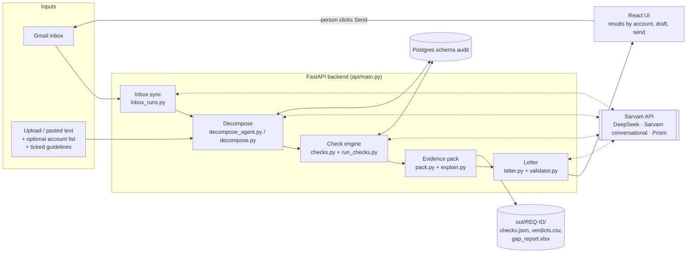
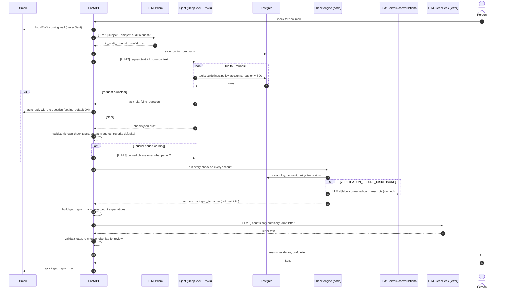
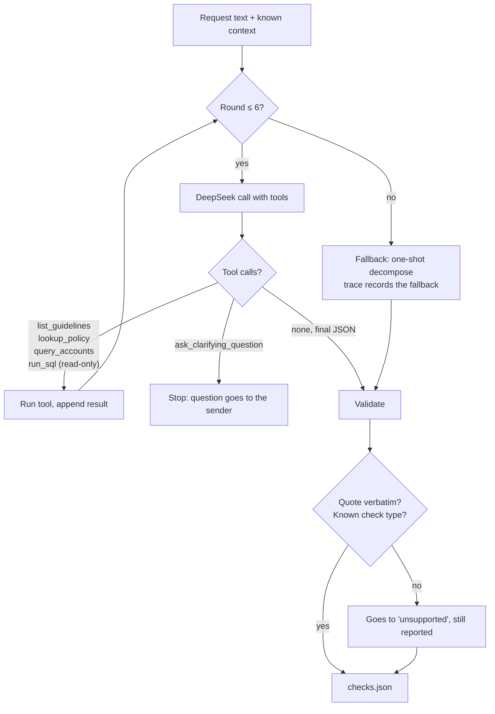
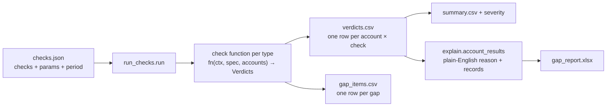

# Audit Evidence Pack Agent — Low-Level Design

How an audit request becomes a tested, evidenced reply: the components, the flow, **exactly where an
LLM is called**, where the agent loops, and the guardrails around each call.

**One rule drives the whole design: the LLM reads and writes; plain code decides.** No pass/fail verdict,
severity, count or evidence link ever comes from a model.

---

## 1. System context

Dotted lines are the only places an LLM is involved (section 3).

---

## 2. End-to-end flow (Gmail-sourced run)

---

## 3. LLM inventory — every call site

| # | Step | Code | Model (config) | Input | Output | Guard rails | If it fails |
|---|------|------|----------------|-------|--------|-------------|-------------|
| 1 | Inbox scoring | `inbox_runs._classify` | Sarvam **Prism** (`SARVAM_MODEL_DECISION`), `/v2/systemone` | email subject + snippet | `is_audit_request`, confidence | Informational. A message that was already run is never hidden. | `None` score; the message still lists |
| 2 | Understand the request | `decompose_agent.decompose_with_tools` | **DeepSeek** (`SARVAM_MODEL_REASONING`) with tool calls | request text + facts the pipeline already fixed (lender, accounts, period) | `checks.json` draft, or a clarifying question | Output must pass: closed list of check types; `source_text` verbatim in the request; severity defaults; max 6 rounds | After 6 rounds it falls back to the one-shot `decompose()`; the fallback is recorded in `agent_trace` |
| 2b | One-shot fallback | `decompose.decompose` | DeepSeek | request text | same shape | Same validation | Run fails with a clear error |
| 3 | Period double-check | `decompose._llm_period_from_quote` | DeepSeek | only the quoted period phrase | from/to dates or none | Isolated: sees no other context, so it cannot rubber-stamp | Treated as "no period"; never guesses |
| 4 | Call-transcript labels | `transcript_review.label_calls` | **Sarvam conversational** (`SARVAM_MODEL_CONVERSATIONAL`) | transcript of each connected call in the request | label: ok / disclosure before verification / after failed verification / third-party disclosure | Cached forever in `audit.transcript_labels`; only calls in this request | Unlabelled call becomes CANNOT_DETERMINE, never compliant |
| 5 | Draft letter | `letter.draft_and_validate` | DeepSeek | **summary counts only** (no account rows) | letter text | `validator.validate`: no softening words, no unmasked numbers, DRAFT disclaimer, mentions gaps and limits; results table inserted by code | One retry with the failure reasons, then `needs_human_review` |

Not an LLM, but related: the auto-reply of a clarifying question (`_auto_reply_with_clarification`) sends the
agent's own question text. It is controlled by the `auto_reply_clarification` setting (`audit.app_settings`,
**default ON**). The final evidence letter is never sent automatically.

---

## 4. The agent loop (decompose step)

| Tool | Reads | Notes |
|------|-------|-------|
| `list_guidelines` | `audit.guidelines` (RBI / lender catalogue) | Lets the agent match vague wording to a real rule |
| `lookup_policy` | `audit.policy` for the lender | Hours, call caps, notice deadlines |
| `query_accounts` | `audit.accounts` | Confirms account ids exist and whose they are |
| `run_sql` | any `audit` table | Runs on the **`audit_readonly` role** (SELECT only, enforced by Postgres) and returns at most 50 rows |
| `ask_clarifying_question` | none | Ends the run; the question goes to the sender instead of a guess |

The full tool-call trail is stored in `checks.json` (`agent_trace`) and echoed in the run log.

---

## 5. Deterministic engine (no LLM decides anything here)

**Verdict rule (`agent/verdict.py`):** `NOT_APPLICABLE` if nothing was tested → `GAP` if any gap →
`CANNOT_DETERMINE` if anything is undetermined → otherwise `EVIDENCED`, which **requires evidence IDs**.
Severity comes from the request's own scale, defaulting to the worst level.

**Registered check types (`checks.CHECKS`):** `CONSENT_BEFORE_CONTACT`, `TEMPLATE_APPROVED`, `CALL_HOURS`,
`CALL_FREQUENCY`, `AGENT_CERTIFICATION`, `VERIFICATION_BEFORE_DISCLOSURE`, `CALL_RECORDING`,
`NOTICE_TIMELINE`, `CALLER_NUMBER_SERIES`, `MESSAGE_CONTENT`, `CALL_CONDUCT`, `FIELD_VISIT`,
`SECURITY_RELEASE`, `PENAL_CHARGES`. The decompose prompt is built from this registry, so a new entry is
picked up automatically.

---

## 6. Guidelines catalogue (rules as data)

`audit.guidelines` (loaded from `data/rbi_guidelines.csv`): `guideline_id, category, title, rule_text,
check_type, params_json, source_type (RBI_VERIFIED | LENDER_POLICY | UNVERIFIED), source_ref, testable, needs`.

- Ticked guidelines are **added** to the checks found in the request; a rule already covered (same check
  type + channel) is not run twice (`decompose_from_guidelines`).
- A rule whose data does not exist yet is `testable = N` and states what it needs. It never returns a fake pass.
- **Changing a limit:** edit `params_json`, reload. **A new rule of a known kind:** add a row. **A new kind of
  rule:** add one check function and register it; connect its data first.

---

## 7. Data model (schema `audit`)

| Group | Tables |
|-------|--------|
| Core data | `accounts`, `contact_log`, `transcripts`, `consent`, `templates`, `policy`, `notices`, `certificates` |
| Conduct data | `caller_numbers`, `message_content`, `call_conduct_log`, `field_visits`, `closures`, `penal_charges` |
| Catalogue | `guidelines` |
| App state | `inbox_runs` (saved mailbox list + status), `run_results` (letter + reply details), `transcript_labels` (LLM label cache), `oauth_tokens`, `app_settings` |

Roles: the app connects as the main role; LLM-written SQL connects as `audit_readonly`
(`DATABASE_URL_READONLY`, `sql/008_readonly_role.sql`).

---

## 8. Guardrails summary

| Risk | Control |
|------|---------|
| Model invents a requirement | `source_text` must appear verbatim in the request, else it is reported as unsupported |
| Model invents a check | Only types in the closed `CHECKS` registry can run |
| Model changes data | `run_sql` uses a read-only database role |
| Model decides compliance | It cannot: verdicts, severity and counts are code |
| Model leaks customer data | Letter model receives counts only; validator blocks unmasked numbers |
| Model softens bad news | Validator rejects softening words; one retry, then human review |
| Missing data read as a pass | Becomes `CANNOT_DETERMINE`; `EVIDENCED` needs evidence IDs |
| Wrong email goes out | Final letter needs a click and confirmation; extra tick if flagged. Recipient comes from Gmail's own headers saved with the run, never from the browser |
| Clarifying question sent unreviewed | It states no facts about any account; the setting can be turned off |

## 9. Known gaps and next steps

- No dated or versioned rules: a report does not record which rule version it used. Next: `effective_from` /
  `superseded_by` on the catalogue and a rule-version stamp in every report.
- No automatic watch on RBI publications: a person updates the catalogue.
- Conduct checks on language use keyword lists; they are a first pass and will miss things.
- All data is synthetic. Some catalogue rules are lender policy or apply to specific institutions; the
  `source_type` label says which.
